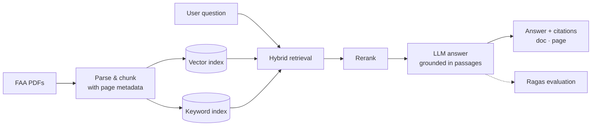

# DocuPilot — RAG Assistant for Aviation Technical Documents

> Ask questions about FAA maintenance guidance in plain language and get **grounded answers with document- and page-level citations** — or a clear refusal when the answer isn't in the documents.


---

## The problem

Aviation maintenance staff work from long regulatory and technical PDFs. Keyword search fails when a technician describes a concept differently from how the document words it, and a general-purpose LLM can produce confident answers that aren't backed by any source. In a safety-critical domain, **every answer needs to be traceable to the exact page it came from.**

## What DocuPilot does

- **Natural-language Q&A** over a curated corpus of FAA Advisory Circulars
- **Hybrid retrieval** — dense vector search *and* keyword search, so both paraphrased concepts and exact terms (AC numbers, form numbers) are found
- **Reranking** of merged candidates before generation
- **Grounded generation** — the model answers only from retrieved passages
- **Inline citations** to the source document and PDF page
- **Refusal** when the corpus doesn't contain the answer, instead of guessing
- **Measured quality** — retrieval and answer faithfulness evaluated against a fixed benchmark

## Architecture



| Layer | Planned technology |
|---|---|
| Ingestion | Python PDF parsing, section-aware chunking, page-number metadata |
| Retrieval | Vector search + keyword (BM25-style) search, reranker |
| Generation | LLM with citation-constrained prompting |
| API | FastAPI |
| Interface | Next.js chat UI with inline source citations |
| Evaluation | Ragas (faithfulness, answer relevance, context precision / recall) |
| Deployment | Docker |

## Document corpus (v1)

Five publicly available FAA Advisory Circulars — **50 pages** in total:

| Document | Topic | Pages |
|---|---|---:|
| AC 43-9D | Maintenance records and FAA Form 8130-3 return to service | 24 |
| AC 20-77B | Use of manufacturers' maintenance manuals | 5 |
| AC 121-22D | Maintenance review boards and OEM/TCH recommended procedures | 10 |
| AC 43-12A | Preventive maintenance | 4 |
| AC 39-7D | Airworthiness Directives | 7 |

Each document is profiled in [`data/document_inventory.md`](data/document_inventory.md) — structure, tables, figures and likely extraction issues — before ingestion. Source PDFs come from the FAA website and are kept out of version control (see [`data/raw/`](data/raw/)).

## Evaluation benchmark

The benchmark was written **before** the pipeline, so the system is measured against a fixed target rather than tuned to its own outputs. [`eval/test_questions.md`](eval/test_questions.md) contains 15 questions, each with an expected answer and its expected source (document, PDF page and section):

| Category | Questions | What it tests |
|---|---|---|
| Direct retrieval | Q1–Q5 | Finding a specific fact on the right page |
| Synthesis / multi-step | Q6–Q10 | Combining evidence across passages |
| Cross-document comparison | Q11–Q13 | Relating guidance from two different ACs |
| Unanswerable | Q14–Q15 | Refusing questions the corpus can't answer |

## Roadmap

- [x] Define scope and select the document corpus
- [x] Document inventory and extraction analysis
- [x] Evaluation set with expected answers and page-level sources
- [ ] PDF ingestion and section-aware chunking with page metadata
- [ ] Vector + keyword indexes and hybrid retrieval
- [ ] Reranking
- [ ] Grounded answer generation with citations and refusals
- [ ] Ragas evaluation and results report
- [ ] FastAPI backend
- [ ] Next.js chat interface
- [ ] Docker deployment

## Repository structure

```
docupilot-rag-assistant/
├── data/
│   ├── document_inventory.md   # per-document analysis of the corpus
│   └── raw/                    # source PDFs (git-ignored)
├── eval/
│   └── test_questions.md       # 15-question benchmark with expected sources
└── plan.md                     # project plan
```

## Author

**Muhammad Ahsan** — AI Engineer · [Portfolio](https://muhammad-ahsan-ai-portfolio.vercel.app) · [LinkedIn](https://www.linkedin.com/in/muhammad-ahsan-a3b738286/) · [GitHub](https://github.com/muhammadahsan3)

> DocuPilot is a portfolio and learning project. It is not an approved source of maintenance data — always consult the official, current FAA documents.
